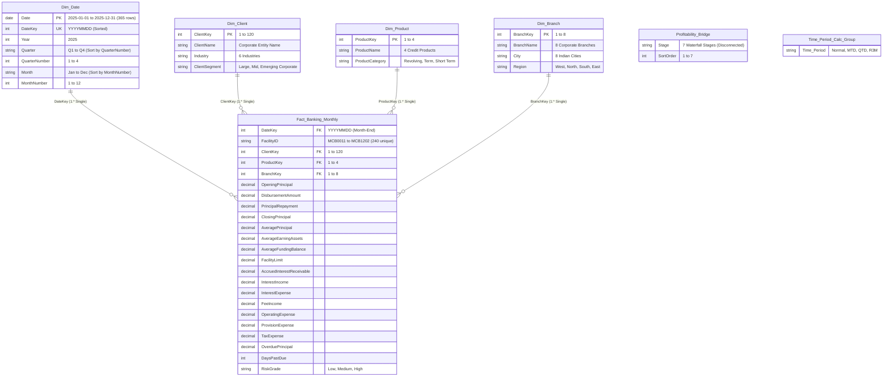

# 🏦 Meridian Corporate Bank — Corporate Banking Profitability & Risk Analytics (Power BI)


## 📌 Executive Summary & Business Problem
Meridian Corporate Bank manages a **₹20.74 Billion** corporate lending portfolio across **120 corporate clients**, **240 credit facilities**, **4 loan products**, and **8 regional branches**. Previously, profitability metrics, funding costs, lending margins, delinquent facilities, and credit loss provisions sat in disconnected spreadsheets.

This 3-page **Power BI Executive Decision Support System** unifies P&L performance and credit risk exposure to answer five core management questions:
1. **Why were Net Profit and Net Interest Margin (NIM) fluctuating month-over-month?**
2. **Was corporate loan book growth translating into bottom-line profit?**
3. **How severely did rising Cost of Funds squeeze lending spreads?**
4. **Which industries, client segments, and facilities were driving Days Past Due (DPD) and High-Risk Exposure?**
5. **How much did expected credit loss (ECL) provision spikes erode Net Profit?**

---

## 📂 Repository Structure

```text
meridian-corporate-bank-powerbi/
├── data/
│   └── Meridian_Corporate_Bank_2025.xlsx       # Raw source dataset (4 sheets, 2,880 fact rows)
├── dashboard/
│   ├── Finance_Dashboard_Final.pbix            # Complete Power BI report (3 pages + Calc Group)
│   └── icons/                                  # Navigation & header icons (Profitability, Facility, Client)
├── dax/
│   ├── 01_calculated_tables.dax                # Dim_Date, Profitability_Bridge, Z_Measures
│   ├── 02_calculation_group_time_period.dax    # Normal, MTD, QTD, R3M calculation items
│   └── 03_measures_library.dax                 # All 35 DAX measures (Base, KPI, Color, Risk, Matrix)
├── docs/
│   ├── DATA_DICTIONARY_AND_VISUALS.md          # Complete schema, sample rows, KPIs & visual specs
│   ├── Meridian_Corporate_Bank_Simple.pptx     # Business problem, banking glossary & reporting logic deck
│   └── Smart_Insights.txt                      # Executive narrative summary
├── assets/
│   ├── 01_overview_profitability.jpg           # Page 1: Executive Profitability & Risk Overview
│   ├── 02_facility_detail.jpg                  # Page 2: Facility-Level Performance & Risk Matrix
│   └── 03_client_summary.jpg                   # Page 3: Client Portfolio Performance & Risk Matrix
└── README.md                                   # Project overview, architecture & scorecard
```

---

## 🖼️ Dashboard Pages Overview
1. **Page 1 — Executive Profitability & Risk Overview (`assets/01_overview_profitability.jpg`):**
   * Top-line KPI cards (`Loan Book`, `Interest Income`, `NII`, `Net Profit`) with dynamic benchmark comparison, area sparklines, and conditional formatting.
   * Annualized rate gauges (`Net Interest Margin: 5.05%`, `Cost of Funds: 5.16%`, `Yield on Advances: 9.91%`).
   * Monthly combo charts tracking `Interest Income vs. Interest Expense + NIM` and `Operating Income vs. Operating Expense + NPM`.
   * 7-stage `Profitability Bridge` waterfall chart walking from `Interest Income` (`₹1.95bn`) to `Net Profit` (`₹0.48bn`).
   * Dedicated `Total Risk Exposure` (`₹7.78B`) and `Total Loan Exposure` (`₹20.74B`) breakdown blocks.
2. **Page 2 — Facility-Level Performance & Risk (`assets/02_facility_detail.jpg`):**
   * Granular facility matrix across all 240 facilities (`MCB0011`–`MCB1202`) sorted by `Days Past Due` (`470 DPD` chronic accounts surfaced at the top) with custom conditional formatting rules and data bars.
3. **Page 3 — Client Portfolio Performance & Risk (`assets/03_client_summary.jpg`):**
   * Hierarchical drill-down (`Industry` $\rightarrow$ `ClientSegment` $\rightarrow$ `ClientName`) evaluating client-level `Loan Book`, `Interest Income`, `Net Profit`, `NIM`, `Overdue Principal`, `High-Risk %`, and `Provision Amount`.

---

## 🏗️ Data Architecture & Star Schema



---

## ⚙️ Key Technical Highlights (Advanced DAX)
1. **Semi-Additive Snapshot vs. Flow Engine:**
   * **Flow KPIs** (`Interest Income`, `NII`, `Operating Income`, `Provision Expense`, `Net Profit`) aggregate across all active months in the period.
   * **Snapshot Balance KPIs** (`Loan Book`, `Performing Loan Book`, `High-Risk Exposure`, `Available Limit`, `30+ / 90+ DPD Exposure`) use a non-blank `Last Available DateKey` pattern (`REMOVEFILTERS(Dim_Date)`) to always return the latest month-end balance on or before any user-selected daily date—preventing balance sheet inflation (`₹20.74B` true portfolio vs. `₹242.39B` naive sum).
2. **Calculation Group Time Intelligence (`SELECTEDMEASURE()`):**
   * Implements `Normal`, `MTD`, `QTD`, and `R3M` (Rolling 3 Months via `EOMONTH(EndDate, -3) + 1`) in a single Calculation Group, eliminating 80+ redundant DAX measures.
3. **Dynamic P&L Waterfall Bridge:**
   * Uses `DATATABLE` and `SWITCH(SELECTEDVALUE(...))` to map inflows (`+₹1.95B` Interest Income, `+₹0.09B` Fee Income) and outflows (`-₹0.96B` Interest Expense, `-₹0.32B` OpEx, `-₹0.13B` Provisions, `-₹0.16B` Tax) to `₹0.48B` (`₹479.20M`) Net Profit.

---

## 📊 FY 2025 Master KPI Scorecard
| Metric | FY 2025 / Dec 2025 Value | Benchmark / Context |
| :--- | ---: | :--- |
| **Loan Book (Dec 2025 Snapshot)** | **₹20.74B** (`₹20,73,78,02,259.82`) | Up **+7.6%** vs. Jan 2025 (`₹19.28B`); `-0.2%` vs. Nov (`₹20.78B`) |
| **Interest Income (FY 2025)** | **₹1.95B** (`₹1,94,86,00,461.39`) | `▲ 9.8%` vs. prior benchmark (`₹1,774.4M`) |
| **Net Interest Income (NII)** | **₹993.34M** (`₹99,33,36,999.27`) | `▲ 10.3%` vs. prior benchmark (`₹900.7M`) |
| **Net Profit (FY 2025)** | **₹479.20M** (`₹47,92,00,373.97`) | `▲ 11.3%` vs. prior benchmark (`₹430.4M`) |
| **Net Interest Margin (NIM)** | **5.05%** | Lowest in June (`4.15%`), highest in Dec (`5.40%`) |
| **Cost of Funds (CoF)** | **5.16%** | Peaked in June at `6.01%` |
| **Yield on Advances (YoA)** | **9.91%** | Range: `9.07%` (Feb) to `10.17%` (Oct) |
| **Performing Loan Book (`DPD = 0`)** | **₹17.01B** (`₹17,00,79,45,062.15`) | **82.01%** of total portfolio |
| **Total Risk Exposure (`Medium` + `High`)** | **₹7.78B** (`₹7,78,32,42,944.09`) | **37.53%** of total portfolio |
| **High-Risk & `30+ DPD` Exposure** | **₹3.73B** (`₹3,72,98,57,197.67`) | **17.99%** of total portfolio |
| **`90+ DPD` Severe Delinquency Exposure** | **₹180.79M** (`₹18,07,86,182.88`) | **0.87%** of portfolio (6 chronic facilities at `470 DPD`) |
| **Available Undrawn Credit Limit** | **₹11.01B** (`₹11,00,95,24,224.84`) | Out of `₹31.75B` total sanctioned Facility Limit |

---

## 💡 Key Business Insights
* **Portfolio Growth:** Loan Book closed at **₹20.74B** in December, up **7.6% vs. January** (`₹19.28B`), led by Corporate Term Loans (`₹8.45B`) and Trade Finance (`₹4.82B`).
* **Peak Lending Revenue:** December recorded the highest monthly Interest Income at **₹174.23M**, **20.9% above February** (`₹144.05M`).
* **September Provision Shock:** September was the only loss-making month (**Net Profit: -₹7.46M**, **NPM: -8.00%**), driven by a **₹76.79M Provision Expense spike** as delinquent accounts crossed risk thresholds.
* **June Margin Squeeze:** Margin compression peaked in June when **Cost of Funds surged to 6.01%**, pulling **NIM down to 4.15%**.
* **Credit Stress Concentration:** Overdue Principal peaked in October at **₹252.90M**. Drill-down into Page 2 (`Facility Detail`) and Page 3 (`Client Summary`) isolates 6 chronic facilities (`MCB1111`, `MCB1112`, `MCB0742`, `MCB0741`, `MCB0371`, `MCB0372`) at **470 Days Past Due** yielding zero interest income, alongside Large Corporate exposures like *Harbor Projects Pvt Ltd* (`₹568M` Loan Book, `₹13.59M` Provision) requiring immediate restructuring.